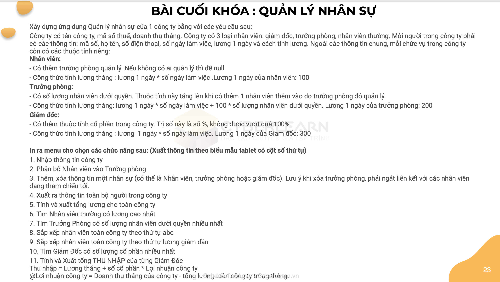
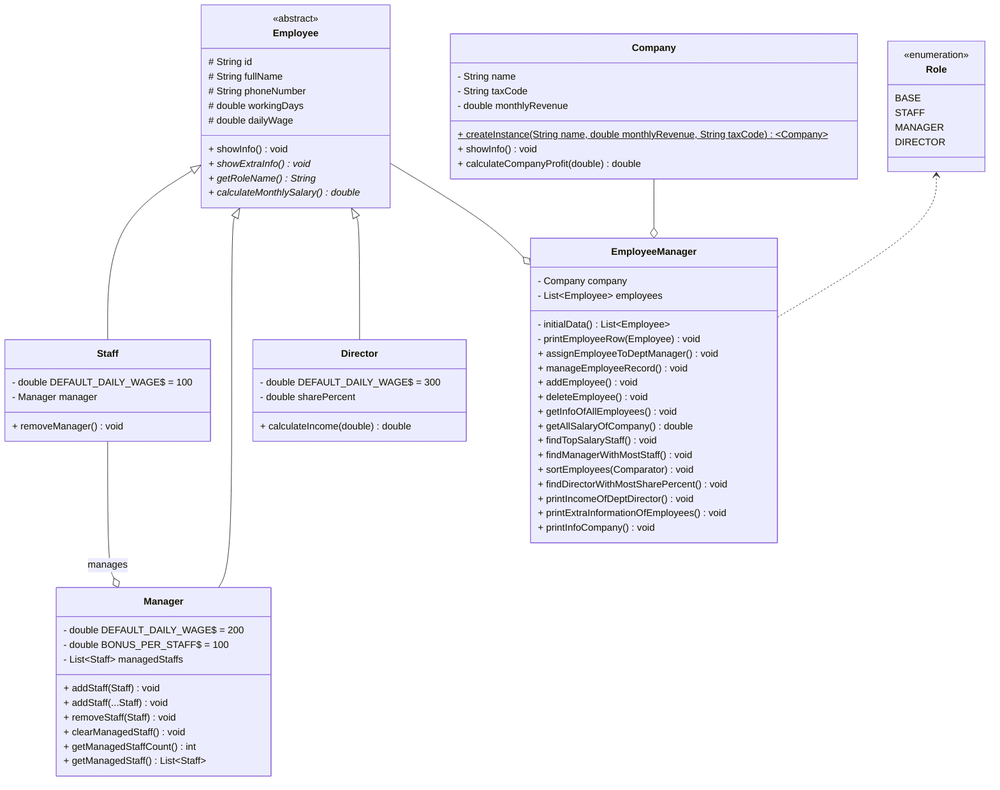

# Java - Capstone 01 - Employees


<!-- TOC -->

* [Java - Capstone 01 - Employees](#java---capstone-01---employees)
    * [Requirements](#requirements)
    * [Class Diagram](#class-diagram)
    * [Features](#features)
    * [Prerequisites](#prerequisites)
        * [Project Structure](#project-structure)
        * [Environment](#environment)
    * [Author](#author)

<!-- TOC -->

## Requirements

Build an HR management application for a company with the following rules.



**Summary**:

- A company has a name, a tax code, and a monthly revenue, and employs three types of staff: **Director**, **Manager**,
  and regular **Staff**.
- Every employee has an ID, full name, phone number, working days, a daily wage, and a salary formula.
- Each role adds its own rules on top of that:

  | Role     | Extra attribute                   | Monthly salary formula                       | Default daily wage |
    |----------|-----------------------------------|----------------------------------------------|--------------------|
  | Staff    | Managed by a `Manager` (nullable) | `dailyWage * workingDays`                    | 100                |
  | Manager  | Count of managed staff            | `dailyWage * workingDays + 100 * staffCount` | 200                |
  | Director | Share percent (0–100%)            | `dailyWage * workingDays`                    | 300                |

- A director's **income** is their salary plus their share of the company's monthly profit:
  `income = salary + sharePercent% * companyProfit` where `companyProfit = monthlyRevenue - totalSalaryOfAllEmployees`.

- The application exposes these operations through a console menu:
    - Enter company info
    - Assign a staff member to a manager
    - Add/delete an employee (unlinking any managed staff when a manager is deleted)
    - List all employees
    - Total monthly salary
    - Top-paid staff
    - Manager with the most staff members
    - Sort by name or by salary
    - Director with the highest share percent
    - Get director's total income.

## Class Diagram



## Features

The console menu supports:

1. Enter company information
2. Assign an employee to a manager
3. Add / delete an employee (Staff, Manager, or Director)
4. Print information of all employees
5. Calculate the total salary of the company
6. Find the staff member(s) with the highest salary
7. Find the manager(s) with the most managed staff
8. Sort employees by name (ascending)
9. Sort employees by salary (descending)
10. Find the director(s) with the highest share percent
11. Calculate and print each director's total income
12. Print extra, role-specific information (by Staff / Manager / Director)
13. Print company information
14. Quit

## Prerequisites

### Project Structure

```txt
./
│   .gitignore
│   README.md
│
├───docs
│       capstone-01-java-core.png
│
└───src
    │   MainApplication.java
    │
    ├───manager
    │       EmployeeManager.java
    │
    ├───model
    │       Company.java
    │       Director.java
    │       Employee.java
    │       Manager.java
    │       Staff.java
    │
    ├───ui
    │       Menu.java
    │       Notification.java
    │
    └───util
            InputHelper.java
            Role.java
```

### Environment

- IDE: IntelliJ IDEA
- JDK: 21 or higher

## Author

Khang Nguyen
